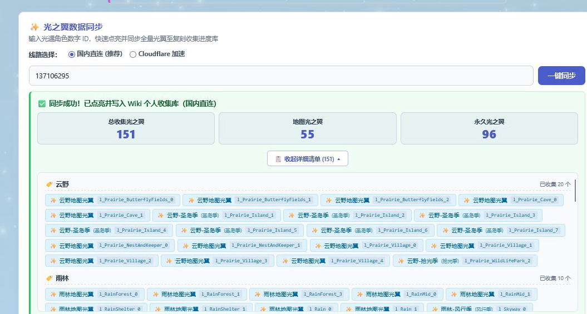
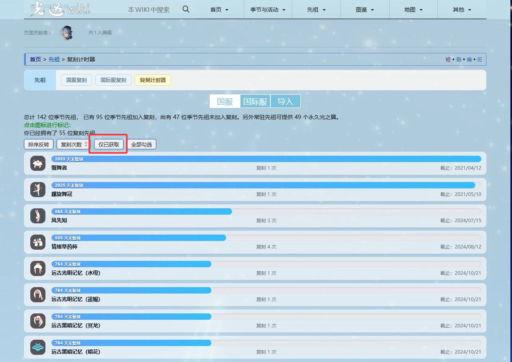

# 光遇 BWiki 复刻计时器与光翼查询板块同步仓库 (sky-bwiki-guangyi-sync)

> 🎮 **线上核心词条**：[https://wiki.biligame.com/sky/复刻计时器](https://wiki.biligame.com/sky/复刻计时器)（永久数字短链：[curid=10607](https://wiki.biligame.com/sky/?curid=10607)）  
> 🧩 **对应核心组件**：[Widget:SynSpirit](https://wiki.biligame.com/sky/Widget:SynSpirit)（[编辑直达](https://wiki.biligame.com/sky/Widget:SynSpirit?action=edit)）  
> 🏷️ **归属组织**：[Sky-GuangYu-BWiki](https://github.com/Sky-GuangYu-BWiki)  
> 📦 **上游核心插件**：[koishi-plugin-wydashen-guangyi-query](https://github.com/VincentZyuApps/koishi-plugin-wydashen-guangyi-query) ⭐ *(光翼数据源与核心算法)*  
> 🛡️ **技术支持与 API**：[VincentZyu](https://github.com/VincentZyu233)（B站个人主页：[VincentZyu](https://space.bilibili.com/34318934)）  
> 🌐 **生产云端 API**：`https://guangyi.vincentzyu233.cn` (国内直连加速) / `https://cf-guangyi.vincentzyu233.cn` (Cloudflare 容灾加速)

---

## 📸 一、 线上实际运行效果

### 1. 线上真实导入与中英文双显清单
玩家输入光遇角色数字 ID，点击「一键同步」后秒级查询网易大神并自动点亮 Wiki 先祖，下方支持展开各地图光翼与先祖详细清单：

<p align="center">
  
</p>

### 2. 复刻计时器宿主大盘全貌与联动效果 (curid=10607)
一键导入后无缝点亮「国服」与「国际服」先祖排期大盘，支持通过上方工具条自由筛选「仅已获取 / 隐藏已获取」，直观查看先祖回归倒计时与收集进度：

<p align="center">
  
</p>

---

## 🧭 二、 核心词条、组件与页面关系

很多新手编辑者容易混淆 Wiki 上这几个页面的对应关系，架构层级梳理如下：

```text
【宿主页面（外壳大舞台）】
 https://wiki.biligame.com/sky/复刻计时器
 (系统唯一数字短链 / PageID: https://wiki.biligame.com/sky/?curid=10607)
 ├── 标签 1: 国服复刻先祖列表（挂载 {{#widget:复刻计时器排序}}）
 ├── 标签 2: 国际服复刻先祖列表
 └── 标签 3: 导入（挂载 {{#Widget:SynSpirit}}） ◀── 本项目核心产物
       └── 用户输入 8 位角色 ID ➔ 查询网易大神数据 ➔ 写入 MediaWiki 用户偏好配置

【前置历史索引表（关联词条）】
 https://wiki.biligame.com/sky/旅行先祖回归记录
 └── 记录自第 1 次至第 200+ 次复刻先祖的时间、价格、季节分类与回归次数汇总。
```

| 页面 / 组件 | 线上真实 URL | 职责与技术定位 |
| :--- | :--- | :--- |
| **复刻计时器** (宿主) | `https://wiki.biligame.com/sky/复刻计时器`<br>（或 `?curid=10607`） | **玩家核心使用端**。包含国服/国际服先祖勾选卡片列表、复刻排期倒计时及导入页签。 |
| **旅行先祖回归记录** | `https://wiki.biligame.com/sky/旅行先祖回归记录` | **全历史大表**。展示全服自开服以来所有旅行先祖回归的物价与详细时间记录。 |
| **Widget:SynSpirit** | `https://wiki.biligame.com/sky/Widget:SynSpirit` | **数据自动同步挂件**。负责跨域网络请求、双线测速容灾、中文字典匹配及 MediaWiki 偏好写入。 |
| **Widget:复刻计时器排序** | `https://wiki.biligame.com/sky/Widget:复刻计时器排序` | **先祖列表工具条**。负责「排序反转」、「复刻次数排序」、「隐藏已获取先祖」、「全部勾选」等前端 DOM 交互。 |

---

## 💡 三、 业务原理：“复刻先祖”与“光之翼”的深层联动机制

> **很多玩家疑问：我明明查的是“光之翼”，为什么会联动点亮“复刻先祖”呢？**

1. **游戏底层的绑定逻辑**：
   - 《光·遇》中光之翼分为两类：
     - **地图小金人**（代码 `l_xxx`，如 `l_Prairie_...`）：地图中直接拾取，献祭后掉落需重跑；
     - **永久光之翼**（代码 `s_xxx`，如 `s_fox` 跳跃狐狸）：通过在遇境先祖兑换树上消耗升华蜡烛（红蜡烛）解锁永久光翼节点，献祭重生后在重生门直接获得。
   - **每一个复刻先祖（旅行先祖）必定包含一个升华蜡烛永久光翼节点**！

2. **网易大神的底层数据结构**：
   - 网易大神接口在返回玩家档案时，返回的字段名为 `wing_buffs`（光之翼增益列表）；
   - 该数组**同时包含了玩家已收集的全部小金人与所有已换过永久光翼节点的先祖代码**！

3. **BWiki 自动化联动的“神级闭环”**：
   - 过去，玩家必须在复刻计时器页面**手动对照游戏挨个查找几十个先祖打勾**，极易遗漏且耗时繁琐；
   - 现在，玩家只需在「导入」页输入角色数字 ID，组件通过 `mw.Api().postWithToken("csrf", ...)` 自动将拥有的先祖集合写入当前玩家的 B 站个人偏好：
     ```javascript
     optionname: "userjs-collectionList-travel_spirit_cn"
     ```
   - 切换到「国服」标签后，所有你换过永久光翼的复刻先祖**全自动亮起并标记为【已获取】**，顶部“你已拥有 XX 位复刻先祖”实时同步为你真实的数据！

---

## 🎯 四、 核心玩法与高级操作技巧

### 1. 结合“隐藏已获取”实现一秒智能查漏补缺
在「国服」列表上方，设有工具条按钮：
`[排序反转]` `[复刻次数]` `[隐藏已获取]` `[全部勾选]`

工具条的筛选按钮为 **三态循环切换**（展示的是“下一步操作指令”）：
- **初始状态**（按钮显示 `隐藏已获取`）：此时展示全部先祖；
- **点击第 1 下**（按钮变成 `仅已获取`）：**🎯 此时真正进入【隐藏已获取】模式！** 屏幕上所有已拿到的先祖瞬间隐去，**仅剩下你从未兑换过的先祖**；
- **点击第 2 下**（按钮变成 `显示全部`）：只展示你已经收集到的先祖；
- **点击第 3 下**：回到初始全部展示状态。

搭配「复刻次数排序」，玩家一眼就能排查出：
- 自己还差哪几位先祖没有拿到永久光翼？
- 哪位尚未获取的先祖已经超过 400~500 天没有复刻（即将大概率返场）？
- 完美规划下一次跑图蜡烛预算！

---

## 🛠️ 五、 核心组件技术特性 (Widget:SynSpirit)

1. **🌐 双线路测速与 6 秒智能容灾 (Failover)**：
   - 默认采用「国内直连（推荐）」极速节点（`guangyi.vincentzyu233.cn`）；
   - 备用集成「Cloudflare 全球加速」节点（`cf-guangyi.vincentzyu233.cn`）；
   - 内置 6 秒超时中断控制器（AbortController），若单线网络出现抖动或阻断，自动无感切换至备用线路重试，彻底杜绝单点故障。

2. **🏷️ 先祖与光翼中英文双显折叠抽屉**：
   - 默认折叠收起，不侵占 Wiki 页面原本版面；
   - 展开后按游戏真实地图（晨岛、云野、雨林、霞谷、暮土、禁阁、暴风眼等）精准分栏；
   - 标签同时展示 **中文地图/先祖定位** 与 **底层英文ID代码**：
     - `✨ 云野地图光翼 l_Prairie_ButterflyFields_0`
     - `✨ 云野-圣岛季 (圣岛季) l_Prairie_Island_1`
     - `✨ 暴风眼-重生门 (重生门) l_Credits_0`
     - `👻 情绪草药师 s_herb`
   - 为英文代码增加等宽字体容器与轻量背景徽章，美观直观，便于对照。

3. **📦 轻量紧凑中文字典内嵌**：
   - 通过本地 `scripts/sync-wing-dict.py` 自动化抽取上游 Koishi 核心插件字典；
   - 包含 259 个地图标签与 388 个先祖译名，编译压缩后仅 ~13.3 KB，零额外网络依赖。

---

## 📂 六、 目录结构说明

```text
sky-bwiki-guangyi-sync/
├── doc/                         # 项目文档与高清裁剪示意图
│   └── images/                  # 线上运行高清实况图集
│       ├── widget-live-preview.png     # 线上 Widget 导入与双显抽屉实测图
│       ├── wiki-page-overview.png      # 复刻计时器页面全貌
│       └── wiki-spirit-return-record.png # 旅行先祖回归记录大表
├── src/                         # 原始源码区（可直接复制粘贴到 BWiki 后台编辑框）
│   ├── data/                    # 光翼与先祖中文字典（从上游 Koishi 插件仓库自动同步）
│   │   ├── wing-dict.json       # 完整版中文映射表
│   │   └── wing-dict.min.json   # 紧凑内嵌版字典 (~13KB)
│   ├── pages/                   # 词条页面源码
│   │   └── 复刻计时器.wikitext    # 复刻计时器主词条的完整 Wikitext (curid=10607)
│   └── widgets/                 # 核心挂件源码（包含原生 JS / CSS / HTML）
│       ├── Widget_SynSpirit.html # 光翼与先祖数据自动查询同步组件 (内嵌中文映射与双线容灾)
│       └── Widget_复刻计时器排序.html # 复刻先祖列表动态排序展示组件
├── test/                        # 本地免安装运行沙盒
│   └── preview_sandbox.html     # 支持双线切换、中文抽屉折叠展开的本地测试沙盒页
├── snapshots/                   # 线上版本快照与元数据
│   └── rev_metadata.json        # 记录 MediaWiki 线上对应的 revid、时间戳与作者
└── scripts/                     # 自动化同步与运维工具
    ├── sync-wing-dict.py        # 从上游 koishi-plugin-wydashen-guangyi-query 提取并生成中文字典
    └── backup_from_wiki.py      # 一键拉取线上最新状态并生成本地差分
```

---

## 🚀 七、 管理员上线与日常维护 SOP

### 1. 代码更新上线（30 秒部署）
1. 打开本地最新代码：[Widget_SynSpirit.html](src/widgets/Widget_SynSpirit.html)，按 <kbd>Ctrl</kbd> + <kbd>A</kbd> 全选复制；
2. 浏览器打开后台编辑：[编辑 Widget:SynSpirit](https://wiki.biligame.com/sky/Widget:SynSpirit?action=edit)；
3. 全选覆盖粘贴，填写摘要（如 `feat: 升级双线路容灾、中英文双显清单`），点击 **「保存更改」**；
4. 提示“新更改等待审核”时，拥有审核权的管理员核准通过即可生效。

### 2. 线上缓存强刷（Purge 机制）
若修改了 Widget 后宿主词条未立即刷新，可通过向 API 发送 Purge 指令清除服务端 Parser 缓存：
```bash
curl -X POST "https://wiki.biligame.com/sky/api.php?action=purge&titles=复刻计时器&format=json"
```

### 3. 数据离线归档与闭环
上线完成后，运行备份脚本将线上最新的 `revid` 同步写入本地快照：
```bash
python scripts/backup_from_wiki.py
```
若上游光遇版本新增了地图光翼或先祖，运行提取脚本更新字典：
```bash
python scripts/sync-wing-dict.py
```

---

## 🖼️ 八、 静态素材托管与 BWiki 原生图床 SOP

在 Wiki 页面中为组件增设“获取游戏 ID 教程”等图片素材时，**素材托管平台的选型直接决定了国内玩家的访问体验与加载速度**。

### 1. 为什么坚决使用 BWiki 原生图床？（平台选型避坑）

| 托管方案 | 国内访问连通性 | 稳定性与潜在风险 | 推荐结论 |
| :--- | :---: | :---: | :--- |
| **GitHub RawContent**<br>(`raw.githubusercontent.com`) | 极差 ❌ | 确定裂图 | **不可行**。国内绝大多数地区存在 DNS 污染和阻断，玩家打开页面必然大面积 404 裂图。 |
| **Gitee 仓库 Raw / 附件** | 极差 ❌ | 防盗链拦截 | **不可行**。Gitee 对外链图片启用了严格的 Referer 防盗链与鉴权机制，外部直接访问会 302 强制跳转至登录页。 |
| **自建服务器 (ECS / Nginx / FastAPI)** | 良好 ⭐ | 消耗带宽与算力 | **完全没必要**。无论是在 Nginx 配置静态资源目录，还是在 FastAPI 等后端自定义 Endpoint 流式返回图片（如 `FileResponse`），虽然能连带享受现有的双线路容灾体系，但让业务后端去扛大图与长图传输不仅平白增加了后端代码与运维复杂度，更会直接消耗个人 ECS 云服务器极其宝贵的出网下行带宽与流量计费，属于典型的反模式设计。 |
| **BWiki 官方原生图床**<br>(MediaWiki 文件系统) | **顶级 (100%)** 💯 | **B站官方 CDN 永久托管** | **⭐ 最佳方案（强烈推荐）**。直接依托 Bilibili 全国 CDN 网络（`patchwiki.biligame.com`），国内毫秒级极速响应，**完全不消耗个人云服务器资源，且永久无防盗链困扰**！ |

### 2. 教程素材上传实操步骤（以游戏 ID 查询指引为例）

1. **准备本地素材**：
   - 上游参考图：`external/wydashen-guangyi-query/assets/tutorial/tutorial_20260614_html.png`（469×1114 高清竖版长图，大小约 385 KB）。
2. **打开 BWiki 上传页面**：
   - 登录拥有编辑权限的 B 站账号，访问：[BWiki 光遇站 - 特殊:上传文件](https://wiki.biligame.com/sky/Special:%E4%B8%8A%E4%BC%A0%E6%96%87%E4%BB%B6)（或在任意维基页面左侧导航栏点击「上传文件」）。
3. **上传文件并设置规范名称**：
   - **源文件**：点击“选择文件”，上传本地的 `tutorial_20260614_html.png`；
   - **目标文件名**：建议填写清晰、带语义的规范名称，例如：  
     `光遇_游戏ID查询教程指引.png`（需保留扩展名）；
   - **文件说明/摘要**：可填写 `复刻计时器光翼同步组件-游戏ID获取指引`；
   - 点击底部 **「上传文件」** 按钮提交。
4. **提取官方 CDN 终生直链**：
   - 上传成功后自动跳转到维基词条：`https://wiki.biligame.com/sky/File:光遇_游戏ID查询教程指引.png`；
   - **鼠标右键点击图片 ➔ 选择「复制图片链接」**，即可获得类似如下的官方 CDN 最终外链：
     ```text
     https://patchwiki.biligame.com/images/sky/3/3b/ooinnj9wbc7arn71e208jypticidoag.png
     ```

### 3. 组件（Widget）端接入交互建议（Modal 弹窗灯箱）

由于指引图属于纵向长图（`469 × 1114`），直接平铺展示会大幅拉伸页面导致排期列表严重下沉。**推荐采用轻量半透明毛玻璃 Modal 灯箱交互**：

- **入口**：在输入框描述右侧放置 `📖 如何获取游戏 ID？` 链接；
- **弹窗**：点击后弹出居中遮罩层，限制最大高度为屏幕的 85%（`max-height: 85vh; overflow-y: auto;`）；
- **关闭**：支持点击右上角 `✕`、点击半透明背景遮罩、或按下键盘 <kbd>Esc</kbd> 键秒速退出；
- **优点**：平时界面保持极致轻简，按需呼出，兼顾手机端与桌面端自适应体验。

### 4. 线上真实 CDN 产物展示

> 🔗 **官方 CDN 直链与原图直达**：  
> [https://patchwiki.biligame.com/images/sky/3/3b/ooinnj9wbc7arn71e208jypticidoag.png](https://patchwiki.biligame.com/images/sky/3/3b/ooinnj9wbc7arn71e208jypticidoag.png)

<p align="center">
  <a href="https://patchwiki.biligame.com/images/sky/3/3b/ooinnj9wbc7arn71e208jypticidoag.png" target="_blank" rel="noopener noreferrer">
    
  </a>
</p>


